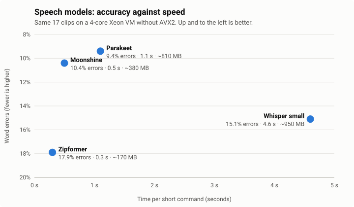
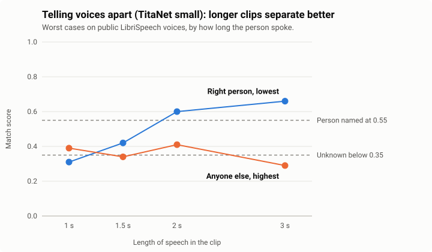
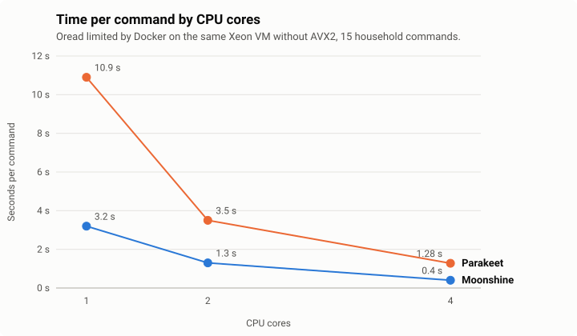

# Oread

*The community version of Oread, built on open models.*

**Hear the words. Know the voice.** Oread is a self-hosted service that turns
what people say to your voice satellites into text and creates voice identity recognition.
It runs in Docker on your own machine, on the processor alone, with no cloud
service and no account.

Your voice assistant sends Oread the audio, one listening port per device. 
Oread answers with the words, and with the person it recognises, or "unknown" when it isn't sure.

## Why "Oread"

In Greek myth the Oreads are the nymphs of the mountains. The best known,
Echo, was left able only to repeat the voices she heard, and the Oreads knew
each voice that came across the hills. Oread does the same work: it listens,
gives the words back, and knows whose voice it was.

## What it does

- **Speech to text, locally.** Pick from several open models per device:
  Moonshine (the default), Parakeet, Zipformer or Whisper. Or add another.
- **Who spoke.** Every request gets a voiceprint. Oread names a person only
  once a human has taught it their voice.
- **Learn** page makes assigning a new person or creating profile easy.
- **Phrase habits.** When the voice match is close, the phrases a person
  habitually uses can settle it, but they never override a clear match.
- **One port per device**, so Oread knows which satellite heard each request.
  Device types (Voice PE, tablet, laptop, or your own) give each kind of
  device its starting models.
- **Compare models on your own audio.** Try another model on the clips a
  device already recorded, side by side, before you switch.
- **Pages for everything:** Learn, People, Devices, Settings, Imports
  (where every model is downloaded from), Connections, Try it (speak from
  your browser), Stats (memory, CPU, speed, phrase habits), Users and the
  Setup guide.
- **Nothing hard-coded.** Models, their settings and device types live in
  files you can override (`models.yaml`, `device-types.yaml`, with your own
  copies in `data/`), and are editable on the pages.

## How it fits

```
voice device ─▶ any Wyoming client ─audio─▶ Oread (the device's own port)
                (Home Assistant, ...)  ◀─── the words, and who spoke
```

Optional outputs: a Home Assistant sensor per device
(`sensor.oread_<device>_speaker`), a Wepwawet router, or the API.
Example: [connecting Home Assistant](docs/user-guide.md#appendix-a-example-connecting-home-assistant).

## Use case

Oread is used in homes with custom Home Assistant setups, and in commercial
IoT applications that need fast, local voice and acoustic processing.

## How the models compare

Measured on the same 17 clips (15 household commands, a public LibriSpeech
clip and a silence check) on a 4-core Xeon VM without AVX2 (if it runs on a box this old it should run on anything):



| Speech model | Word errors | Exact transcripts | Time per command | Memory |
| --- | --- | --- | --- | --- |
| Parakeet | 9.4% | 11 of 17 | ~1.1 s | ~810 MB |
| Moonshine (default) | 10.4% | 11 of 17 | ~0.5 s | ~380 MB |
| Whisper small | 15.1% | 9 of 17 | ~4.6 s | ~950 MB |
| Zipformer | 17.9% | 6 of 17 | ~0.3 s | ~170 MB |




At 2 seconds or more, the right person's worst score is above the "named"
line (0.55) and everyone else's best score stays near or below the
"unknown" line (0.35). That's why clips under 2 seconds can be matched but
not used to teach a voice. Both thresholds belong to the voice model and can
be changed on the Settings page.

The charts are drawn from the benchmark numbers by
`docs/images/make_charts.py`.

## Will it fit on a small machine?

Oread runs on the CPU alone. What it needs depends mostly on the models you
choose, because each model is loaded once and shared by every device that
uses it.

| Piece | On disk | In memory |
| --- | --- | --- |
| Docker image (Python, sherpa-onnx, Oread; no models) | 398 MB (96 MB compressed) | |
| Moonshine (default speech model) | 275 MB | ~380 MB |
| Zipformer | 319 MB | ~170 MB |
| Parakeet | 631 MB | ~810 MB |
| Whisper small | 1.3 GB | ~950 MB |
| TitaNet small (default voice model) | 39 MB | ~40 MB |
| Oread running Moonshine and TitaNet | | ~535 MB, measured |
| The same with Parakeet loaded too | | ~1.25 GB, measured |

Sizes measured on the test server. Models are downloaded the first time
they're used, never baked into the image, so a small install with only the
defaults needs about 0.7 GB of disk in all. Check your own install with `docker image ls` and
`du -sh ~/docker/oread/models/*`; the **Stats** page shows live memory, CPU
and request speed, made for choosing hardware.



| CPU cores | Moonshine | Parakeet |
| --- | --- | --- |
| 1 | 3.2 s | 10.9 s |
| 2 | 1.3 s | 3.5 s |
| 4 | 0.4 s | 1.28 s |
| Oread's peak memory | ~650 MB | ~1.3 GB |

**Raspberry Pi:** use a 64-bit OS (arm64); sherpa-onnx ships arm64 builds, so
the same Dockerfile builds there. A Pi 5 with 8 GB has room for Moonshine
and TitaNet with plenty to spare, and probably for Parakeet. Speed on a Pi
hasn't been measured yet, so expect slower replies than the numbers above,
and start with Moonshine or Zipformer.

**Wepwawet:** Used in conjunction with Wepwawet you have a trainable voice identification and STT correction module that learns as you use it.

## Security

- HTTPS and certs.
- Every API call needs a signed-in person or an API token with a role
  (viewer, reviewer, administrator, super).
- The listening ports accept only the clients you permit (whitelisted)

## Tested devices

- **[Home Assistant Voice PE](https://www.home-assistant.io/voice-pe/)**, as itself
  (the `voice-pe` device in the tests).
- **A low-end EcoPad Android tablet** running **[Ava Pro](https://github.com/knoop7/Ava-Pro)**,
  which connects it to [Home Assistant](https://github.com/home-assistant/core)
  (the `tablet` device in the tests).
- **A Lenovo IdeaPad running Ubuntu 24.04**, its own microphone through
  `tools/client.py` (the `laptop` device in the tests).

Versions and details: [docs/tested-devices.md](docs/tested-devices.md).


## Get started

```bash
mkdir -p ~/docker && cd ~/docker
git clone https://github.com/coderpigsfly/oread.git
cd oread
docker compose up -d --build
docker compose logs -f oread     # the first-run setup code is printed here
```

Then open `https://<server>:10311/`. The **[user guide](docs/user-guide.md)**
walks through everything from install to connecting Home Assistant
(Appendix A) and troubleshooting, and is also on Oread's **Setup guide** page.

## More
- [User guide](docs/user-guide.md): setting up and using Oread.
- [Technical reference](docs/reference.md): how the parts work, the
  resource log, tests and library versions.
- API: everything the pages do, as JSON, with an interactive page at
  `/docs` once you're signed in.

## Important Reach Out
One of our volunteer trainers speaks with an extreme lisp impediment. We thank you for your patience, tutelage and so glad you can now use a voice device.

## Contributing

- **Devices:** test yours and add a row to [docs/tested-devices.md](docs/tested-devices.md).
- **Models:** add one through `models.yaml` (see the **Imports** page).
- **Code and docs:** issues and pull requests are welcome.

## About this project

Built on the author's own code base, with AI-assisted extensions and clean-up.
The documentation was written with AI and proofread by a second AI, under the
author's direction and review.

## Models and licenses

Oread is Apache 2.0 (see `LICENSE` and `NOTICE`). The models are downloaded
separately and each has its own license; check it on the model's card
(linked on the **Imports** page) before you use it.

| Model | Author | License |
| --- | --- | --- |
| [Moonshine base](https://github.com/usefulsensors/moonshine) (speech, default) | Useful Sensors | MIT |
| [Parakeet TDT 0.6B v2](https://huggingface.co/nvidia/parakeet-tdt-0.6b-v2) (speech) | NVIDIA | CC BY 4.0 |
| [Zipformer, LibriSpeech](https://huggingface.co/Zengwei/icefall-asr-librispeech-zipformer-2023-05-15) (speech) | k2-fsa / icefall | Apache 2.0 |
| [Whisper small.en](https://github.com/openai/whisper) (speech) | OpenAI | MIT |
| [TitaNet Small](https://catalog.ngc.nvidia.com/orgs/nvidia/teams/nemo/models/titanet_small) (voices, default) | NVIDIA | Apache 2.0 (NeMo toolkit) |
| [CAM++ English](https://www.modelscope.cn/models/iic/speech_campplus_sv_en_voxceleb_16k) (voices) | 3D-Speaker | Apache 2.0 |
| [WeSpeaker ResNet34](https://github.com/wenet-e2e/wespeaker/blob/master/docs/pretrained.md) (voices) | WeSpeaker | CC BY 4.0 (as its training data, VoxCeleb) |
| [Silero VAD](https://github.com/snakers4/silero-vad) (voice detector, laptop client) | Silero | MIT |

The Explore page bundles jQuery, jQuery UI and PivotTable.js (MIT); see
`oread/web/vendor/LICENSES.md`.

The test clips in `tests/audio/` and the sample household's in `sample/clips/`
are from [LibriSpeech](https://www.openslr.org/12) (Panayotov et al.), CC BY 4.0.

All run through [sherpa-onnx](https://github.com/k2-fsa/sherpa-onnx), as int8
versions it packages.
